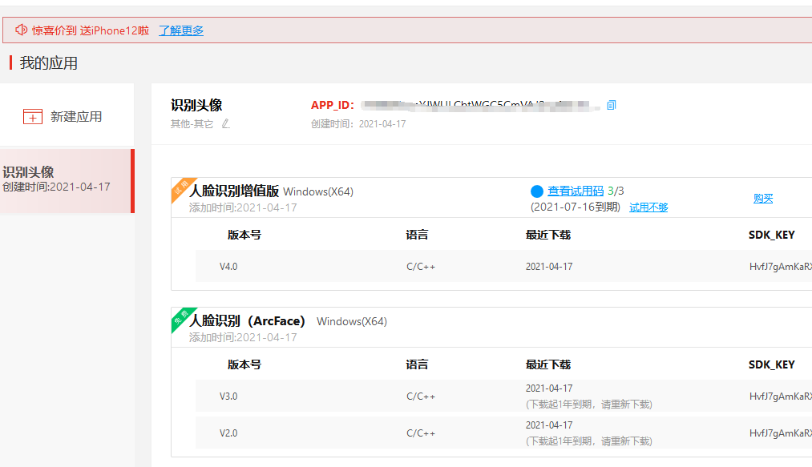
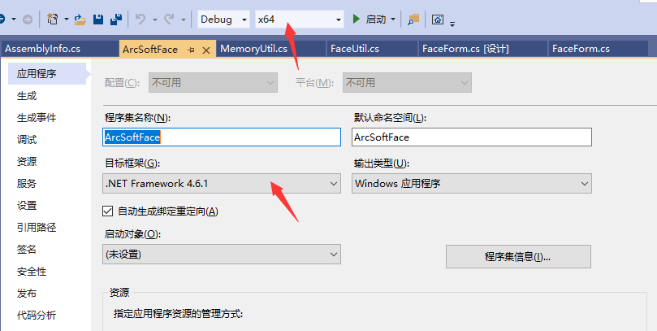
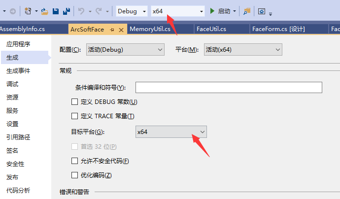

# 档案管理系统人脸识别

| 版本 | 说明                                                         | 日期     |
| ---- | ------------------------------------------------------------ | -------- |
| V0.1 | 实现基本功能                                                 | 20210420 |
| V0.2 | 1剥离出单独线程跑图片识别<br>2独立线程写入主线程TextBox，设置TextBox.CheckForIllegalCrossThreadCalls = false; | 20210420 |
|      |                                                              |          |


### 1. 需求：

将“补发婚姻登记正审查处理表”从其他带有头像比如结婚证之类的的图片中拾取出来。

### 2. 思路：

1. 截取图片下四份之一

2. 对图片人脸识别，只要带有人脸则认为是`补发婚姻登记正审查处理表`

### 3. 解决方案

1. #### 使用“ArcSoftFace”组件，依赖如下两个文件：

```
libarcsoft_face_engine.dll
libarcsoft_face.dll
```


[虹软](https://ai.arcsoft.com.cn/ucenter/resource/build/index.html#/index)   15621030518

使用是ArcFace（免费）Windows（X64）V3.0版本

```
V2.0版经验证不能有效的识别人脸
```



2. ####  因使用64位版本，因此需配置平台为64位版，否则将导致软件在运行过程中`闪退`

`貌似改为x64后还有闪退问题，闪退问题一直未发现原因。`







### 4. 使用说明

1.  确定操作系统为windows 64位系统；

2.  需安装windows framework4.6.1

https://www.microsoft.com/zh-CN/download/details.aspx?id=49981

3

